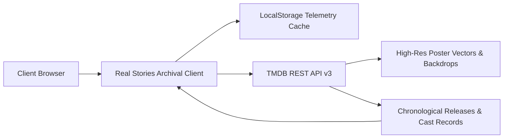

<div align="center">
  

  <p><strong>Curated Historical Cinema Explorer &middot; True-Story Archival Intelligence</strong></p>

  [](https://www.themoviedb.org/)
  [](https://developer.mozilla.org/en-US/docs/Web/JavaScript)
  [](https://opensource.org/licenses/MIT)

  <br/>

  <a href="https://yasmenmad.github.io/REAL-STORIES/"><strong>Verified Live Deployment</strong></a> &middot;
  <a href="https://github.com/yasmenmad/REAL-STORIES"><strong>GitHub Source</strong></a>
</div>

---

## Overview

**Real Stories** is an archival cinema discovery portal dedicated exclusively to masterworks based on real historical events, political chronicles, scientific breakthroughs, and true human accounts.

By interfacing directly with the **The Movie Database (TMDB) API**, the platform structures historical cinema across discrete historical epochs and thematic classifications &mdash; enabling cinephiles and researchers to filter world history through cinema.

---

## Thematic Taxonomy & Archival Eras

The catalog organizes cinema across structured historical themes:

- **Unbelievable Accounts:** Astonishing real events, survival odysseys, and verified anomalies.
- **Music & Cultural Legends:** Transformative figures in art, literature, and twentieth-century sound.
- **Dark Crime & Heists:** Forensic docudramas, corporate frauds, and criminal trials.
- **Scientific Genius:** Pioneers in theoretical physics, mathematics, and codebreaking.
- **War & Epic Survival:** Historical combat operations and humanitarian rescues.
- **Royal Chronicles & Politics:** Dynastic power struggles, diplomacy, and civil rights movements.

---

## Architectural Stack



---

## Installation & Local Execution

```bash
# Clone repository
git clone https://github.com/yasmenmad/REAL-STORIES.git
cd REAL-STORIES

# Serve locally
python -m http.server 8080
```

Access the historical archive at `http://localhost:8080`.

---

## Author

- **Engineer:** Yasmine Daoudi
- **Focus:** Data Systems & Interactive Web Architectures
- **Contact:** [yasmineedaoudii@gmail.com](mailto:yasmineedaoudii@gmail.com) &middot; [LinkedIn](https://www.linkedin.com/in/yasmine-daoudi-eng)
